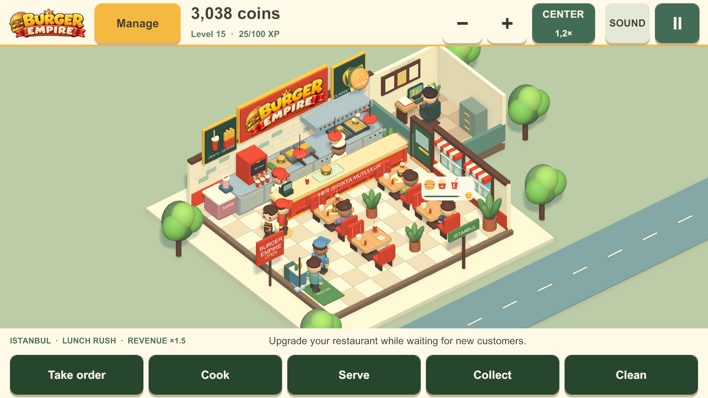
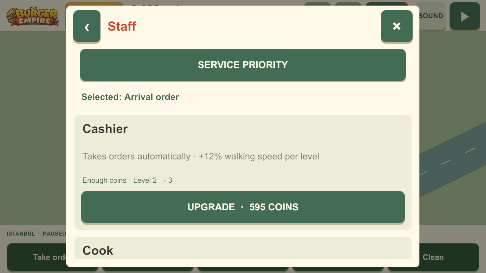
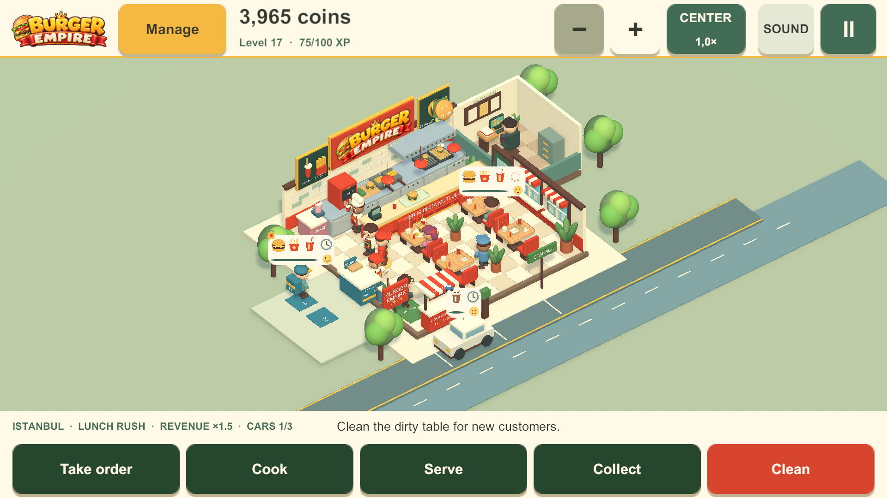

# Burger Empire

**Sipariş al, mutfağı yönet, restoranını büyüt.**

Unity ve C# ile geliştirdiğim restoran yönetimi prototipi. Müşteri siparişlerini, çalışanları ve servis akışını yönetirken restoran düzenini ve işletmenin ilerlemesini kontrol ediyorsun.

**Geliştirici:** [Ulaş Cem Kılıç](https://github.com/Ucemklc) · **Unity:** 6000.3.20f1 · **Dil:** C# · **Render:** URP · **Hedef:** Android

[Kaynak projeyi indir](burger-empire-source.zip) · [Simülasyon kodu](Simulation.cs) · [Kayıt sistemi](ProgressStore.cs) · [Diğer oyunum: Neon Courier](https://github.com/Ucemklc/neon-courier)

## Oynanış

**Sipariş → pişirme → servis → ödeme → temizlik → geliştirme**

- Müşteri siparişlerini takip et, masaların ve mutfağın iş akışını yönet.
- Personeli geliştir ve servis önceliklerini belirle.
- Restoran yerleşimini düzenle; menü, şube, paket servis ve araçtan servis sistemlerini keşfet.
- Vardiya, VIP müşteriler, değerlendirmeler ve başarımlar üzerinden ilerle.

## Oyun içinden

| Personel yönetimi | Araçtan servis ve restoran operasyonu |
| --- | --- |
|  |  |

Görüntüler yerel geliştirme sürümü 0.30'dan alınmıştır. Kaynak arşivindeki yayın planı 0.31.0 sürümünü hedefler.

## Teknik olarak neler var?

| Sistem | İncelenecek kod | Öne çıkan nokta |
| --- | --- | --- |
| Oyun simülasyonu | [Simulation.cs](Simulation.cs) | Restoranın işleyişi ve ilerleme verileri |
| Kayıt / yükleme | [ProgressStore.cs](ProgressStore.cs) | Geçici dosya, yedekten kurtarma ve geçersiz kayıt kontrolü |
| Yerleşim | [RestaurantLayout.cs](RestaurantLayout.cs) | Restoran düzenine ait veri ve kurallar |
| Yerelleştirme | [Localization.cs](Localization.cs) | Dil seçimi ve arayüz metinleri |
| Ödül akışı | [RewardedAdFlow.cs](RewardedAdFlow.cs) | Ödüllü reklam akışının prototip mantığı |

Arşivde `Core` oyun mantığını, `Runtime` Unity sunumunu ve arayüzü, `Editor` ise kurulum ve doğrulama araçlarını içerir. Depo kökündeki C# dosyaları hızlı inceleme için seçilmiş kopyalardır; proje yapısı ZIP arşivindedir.

## Unity'de açma

1. [burger-empire-source.zip](burger-empire-source.zip) dosyasını indirip çıkart.
2. Unity Hub'da çıkarttığın klasörü proje olarak ekle.
3. **Unity 6000.3.20f1** ile aç ve paketlerin yüklenmesini bekle.
4. `Assets/BurgerEmpire/Scenes/BurgerEmpire.unity` sahnesini açıp **Play** düğmesine bas.

Arşiv `Assets`, `Packages`, `ProjectSettings` ve Unity `.gitignore` dosyasını içerir. Önbellekler, yerel oyuncu kayıtları ve imzalama dosyaları dahil değildir.

## Geliştirme durumu

Oyun geliştirme aşamasında bir prototiptir. Ödüllü reklam entegrasyonu editör test akışı seviyesindedir; canlı reklam sağlayıcısı veya mağaza yayını olarak sunulmaz. Bu GitHub düzenlemesi sırasında yeniden derleme veya cihaz testi yapılmadı.

## English overview

A Unity 6 / C# restaurant-management prototype featuring customer orders, staff upgrades, restaurant layout, progression, delivery and drive-through systems. Explore the linked C# samples, or download the source archive to inspect the original Unity project structure. Screenshots show a development build.

## Kullanım hakları

Bu depoda açık kaynak lisansı verilmemiştir. Üçüncü taraf bağımlılıklar kendi lisanslarına tabidir.
